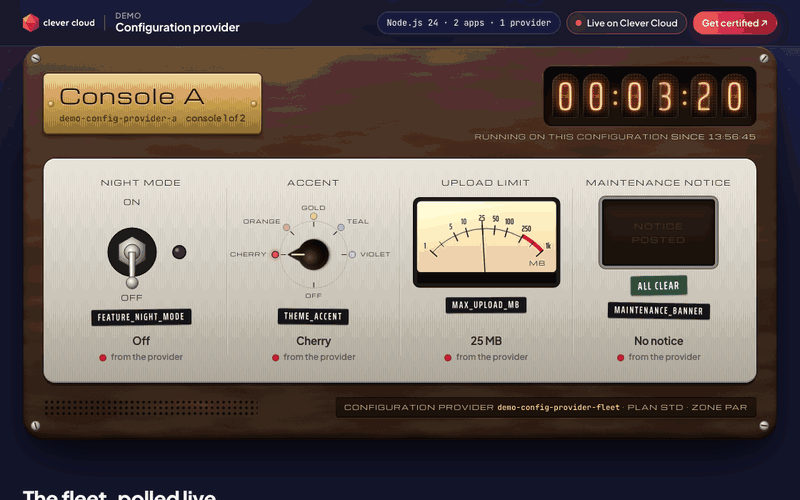
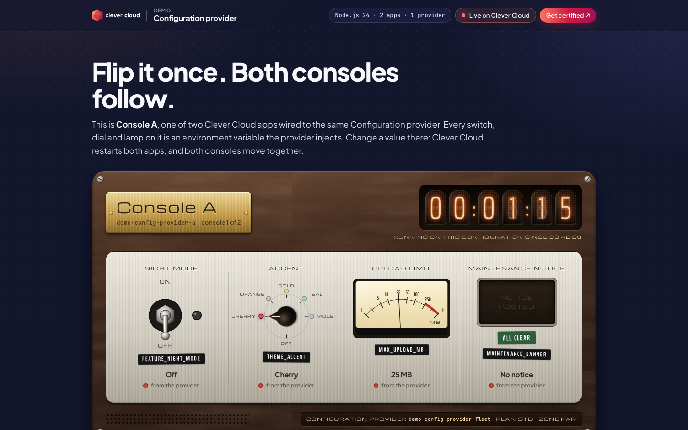
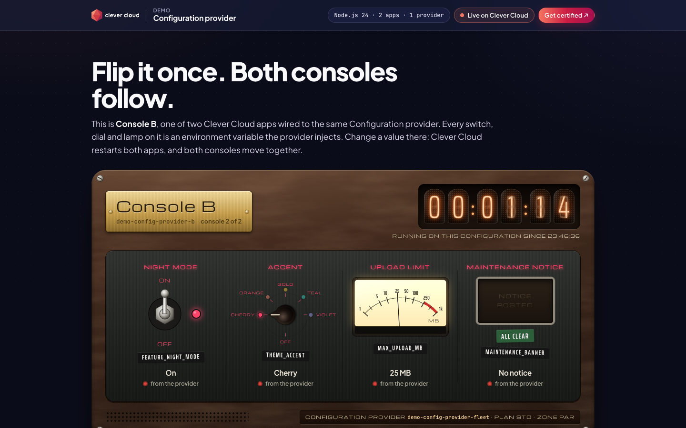
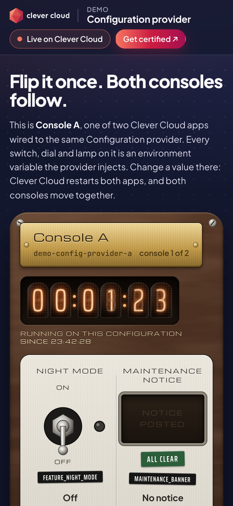
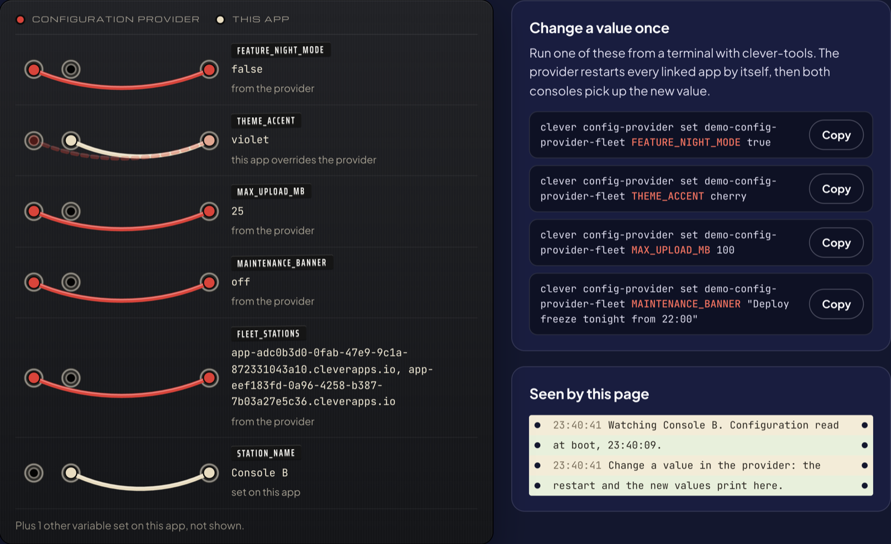

# The Control Panel: one Configuration provider, two Clever Cloud apps

> Flip it once. Both consoles follow.
> Two Clever Cloud apps run the same code and read the same **Configuration provider** add-on. Each one draws its environment as a 1970s console in Bakelite and brushed aluminium: a toggle switch, a rotary selector, a VU meter and an annunciator lamp, with a Nixie-tube counter for the time on the current configuration. Change one value in the provider: Clever Cloud restarts both apps by itself, and both consoles move together. A patch bay shows which variable comes from the provider and which from the app itself.





| Console B after `FEATURE_NIGHT_MODE=true` | On a phone |
|---|---|
|  |  |

**Run it yourself.** The hosted demo was taken down after the presales review (November 2026). The steps in [Deploy on Clever Cloud](#deploy-on-clever-cloud) recreate it from scratch, both consoles and the provider, in about 10 minutes.

**Get certified.** This demo runs on Clever Cloud. To deploy your own apps the same way, get certified at the [Clever Cloud Academy](https://academy.clever.cloud/).

---

## Deploy on Clever Cloud

Same repo, two apps, one provider:

- **Console A** `demo-config-provider-a` (alias `a`) and **Console B** `demo-config-provider-b` (alias `b`), two Node.js apps running the same code;
- **the Configuration provider** `demo-config-provider-fleet`, linked to both. That is the link between them: it injects the same flags into both, and restarts both when a value changes. Each console also polls the other over HTTPS, at the URLs listed in `FLEET_STATIONS`.

You need [clever-tools](https://www.clever.cloud/developers/doc/cli/) (`clever login` done), Node.js 24, and the ID of the organisation that will own the resources (`orga_…`, shown in the Console). Run the commands from the repo root: both `clever create` calls link the same folder, one alias each.

```bash
# 1. Two Node.js apps from this folder, and their size
clever create --type node demo-config-provider-a --alias a --org <org_id> --region par
clever create --type node demo-config-provider-b --alias b --org <org_id> --region par
for a in a b; do
  clever scale --alias "$a" --min-flavor nano --max-flavor XS --min-instances 1 --max-instances 2
  clever scale --alias "$a" --build-flavor M
done

# 2. One Configuration provider (plan std, the only one, free; no encryption option), linked to both
clever addon create config-provider demo-config-provider-fleet --plan std --org <org_id> --region par --yes
clever service link-addon demo-config-provider-fleet --alias a
clever service link-addon demo-config-provider-fleet --alias b

# 3. The shared values, set once in the provider
clever domain --alias a && clever domain --alias b    # each app's default domain
clever config-provider set demo-config-provider-fleet FEATURE_NIGHT_MODE false
clever config-provider set demo-config-provider-fleet THEME_ACCENT cherry
clever config-provider set demo-config-provider-fleet MAX_UPLOAD_MB 25
clever config-provider set demo-config-provider-fleet MAINTENANCE_BANNER off
clever config-provider set demo-config-provider-fleet FLEET_STATIONS "https://<domain-of-a>,https://<domain-of-b>"

# 4. Each app's own variables
clever env set STATION_NAME "Console A" --alias a
clever env set STATION_NAME "Console B" --alias b
for a in a b; do
  clever env set NODE_ENV production --alias "$a"
  clever env set CC_HEALTH_CHECK_PATH /health --alias "$a"
done

# 5. Record which variable comes from where (names only), then deploy
node scripts/trace-wiring.mjs a b
clever deploy --alias a
clever deploy --alias b
clever open --alias a
```

`scripts/trace-wiring.mjs` is the only setup script: it reads `clever env --format json` for each alias and writes the variable **names** into the app's `PANEL_WIRING`. There is no secret to generate. `GET /health/deep` answers 200 once every provider flag is present and valid.

## The punchline

```bash
clever config-provider set demo-config-provider-fleet FEATURE_NIGHT_MODE true
```

That is the only command. The provider restarts every linked app by itself (measured over six changes: each app served the new value 17 to 70 seconds later, usually under 30). Every open console polls itself every 4 seconds: the toggle flips, the room goes dark, the Nixie counter restarts at zero, and the teletype strip prints `FEATURE_NIGHT_MODE false → true`. The fleet strip polls both apps, so one screen shows both consoles changing.

**The app wins.** A variable set on the app overrides the provider's:

```bash
clever env set THEME_ACCENT violet --alias b
node scripts/trace-wiring.mjs b && clever restart --alias b
```

Console B turns violet. Its patch bay plugs the cream "this app" cord into the jack, and the provider's red cord hangs loose beside it. The fleet strip on Console A shows "Differs on THEME_ACCENT". Undo it with `clever env rm THEME_ACCENT --alias b`, then trace and restart again.



---

## Variables

| Variable | Set in | On the console | Accepted values |
|---|---|---|---|
| `FEATURE_NIGHT_MODE` | provider | Toggle switch. Also switches the console to night lighting | `true` / `false` |
| `THEME_ACCENT` | provider | Rotary selector. Sets the colour of every lamp (Clever palette) | `cherry`, `orange`, `gold`, `teal`, `violet` |
| `MAX_UPLOAD_MB` | provider | VU meter needle, log scale | whole number, 1 to 1000 |
| `MAINTENANCE_BANNER` | provider | Annunciator lamp, Dymo tape, and a real site banner | text up to 140 characters; `off` for none |
| `FLEET_STATIONS` | provider | The fleet roster: the app URLs every console polls | comma-separated `https://` URLs |
| `STATION_NAME` | each app | Brass nameplate | text |
| `PANEL_WIRING` | each app | Patch bay sources, written by `scripts/trace-wiring.mjs` | JSON of variable **names** |
| `NODE_ENV` | each app | Required by the Node.js runtime | `production` |

A missing or invalid flag shows as "Not wired" or "Invalid value" on its instrument, and `/health/deep` answers 503.

Platform variables shown in the "Running on Clever Cloud" panel, and nothing else: `CC_APP_NAME`, `APP_ID`, `INSTANCE_NUMBER`, `INSTANCE_TYPE`, `CC_PRETTY_INSTANCE_NAME`, `CC_COMMIT_ID` (short), `CC_DEPLOYMENT_ID`.

## What the Configuration provider does here

- It holds the four flags and the fleet roster in one place, for every linked app ([doc](https://www.clever.cloud/developers/doc/deploy/services/config-provider/)).
- It injects them into each linked app as plain environment variables. The code reads `process.env`, nothing else.
- When one of its values changes, it restarts every linked app. Environment variables are read at boot, so that restart is what delivers the new value.
- A variable set on the app itself wins over the provider's.

**Why `PANEL_WIRING`?** A running process cannot tell a provider variable from an app variable: both are just environment variables. The Clever Cloud API can. `clever env --format json` lists the app's own variables in `env` and the injected ones, per add-on, in `fromAddons`. The trace script keeps the names only, never the values, and stores them in the app's own `PANEL_WIRING` variable. Run it again after adding, removing or overriding a variable. A value change in the provider needs no new trace: values are always read live from the environment.

---

## Routes

| Route | What it returns |
|---|---|
| `GET /` | The console |
| `GET /api/panel` | The flags, sources, roster and allowed platform variables. Readable by the other consoles (CORS `*`), one connection per poll so a restart is seen at once |
| `GET /health` | 200, without reading the provider variables |
| `GET /health/deep` | 200 when every flag the provider should inject is present and valid, 503 otherwise |

Security headers on every response: a strict CSP (no inline script, `connect-src` limited to the fleet), `nosniff`, `no-referrer`.

## Local development

```bash
npm run dev                                                          # Console A on http://localhost:8460
PORT=8466 STATION_NAME="Console B" node --env-file=.env.example server.js   # Console B on :8466
npm test                                                             # node --test, 10 tests
```

Node.js 24 (pinned in `package.json`), no dependencies.

## Project structure

```
server.js                 HTTP server: routes, CSP, page template, graceful SIGTERM
src/panel.js              Reads the flags once at boot, validates them, attaches each name's source
scripts/trace-wiring.mjs  clever env --format json → PANEL_WIRING (names only)
public/index.html         The console markup, Clever Brand Kit frame
public/panel.css          The 1970s universe: Bakelite, aluminium, Nixie tubes, Dymo tape, patch bay
public/app.js             Instruments, springs for the needle and knob, polling, fleet, patch cords
public/cc-brand.css       Clever Brand Kit, copied as-is
test/                     Unit tests (parsing, sources, no leak) and HTTP tests
```

---

Built by [Vitiosum](https://github.com/Vitiosum). MIT license.
